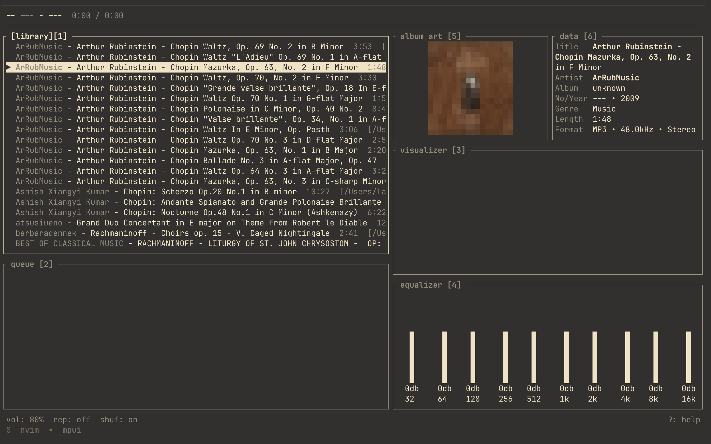
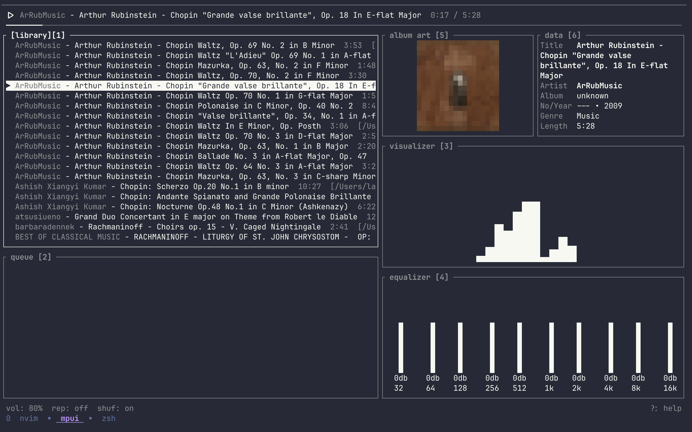

# mpui

lightweight tui music player. rust. vim-native. no bloat.

## screenshots




## build

```sh
cargo build --release
```

## run

```sh
./target/release/mpui
```

## configure

```sh
mkdir -p ~/.config/mpui
cp config/default.toml ~/.config/mpui/config.toml
# edit to taste
```

## termux

```sh
pkg install rust
cargo build --release
```

## keybindings

| key     | action        |
| ------- | ------------- |
| `j`/`k` | move down/up  |
| `enter` | play selected |
| `space` | toggle pause  |
| `/`     | search        |
| `:`     | command mode  |
| `q`     | quit          |

see `config.toml` for full keybinding reference.

> [!TIP]
> You can use the dl.sh script to download videos, in different formats, including downloading playlists in yt

> [!NOTE]
> this is vibe coded
